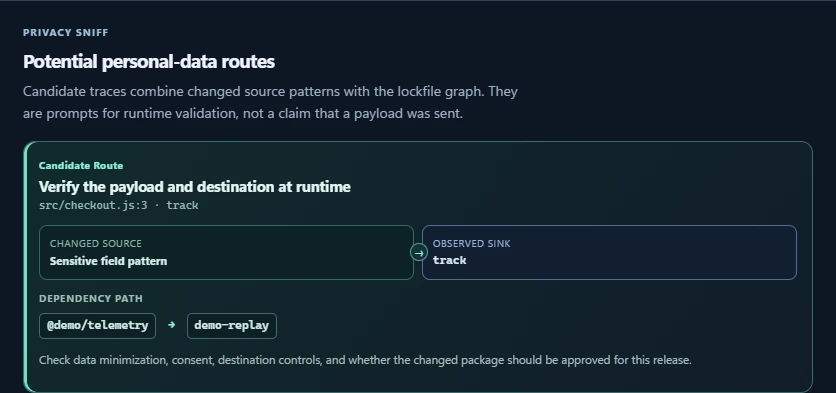

# ReleaseGuard

**Evidence-based deployment review for release owners**

ReleaseGuard brings code changes, test coverage, incident history, and security evidence into a single release review. It returns a **GO**, **CANARY**, or **HOLD** recommendation with a risk breakdown, the evidence behind each finding, and a rollback checklist.

Built by **Team LLmborghini** for **Agent Forge**.

## Quick start

Requires Python 3.10 or newer. ReleaseGuard uses the Python standard library.

```sh
python server.py
```

Open [http://127.0.0.1:8765](http://127.0.0.1:8765). In PyCharm, open the project folder, select a Python interpreter, and run the **ReleaseGuard** configuration or `server.py`.

## Demo walkthrough

| Scenario | How to start | Expected decision |
| --- | --- | --- |
| Checkout release | Select **Checkout privacy route**, then **Run assessment**. | **HOLD · 88/100**. A destructive migration requires a verified restore plan. |
| Checkout timeout change | Select **Moderate service change**, then **Run assessment**. | **CANARY · 24/100**. The update touches the checkout path, leaves one added line uncovered, and matches a past incident. |
| Payment retry | Select **Payment retry logic**, then **Run assessment**. | **CANARY · 19/100**. Coverage reaches eight of nine added executable lines, and incident INC-204 matches the changed module. |
| Receipt label | Select **Low-risk maintenance**, then **Run assessment**. | **GO · 0/100**. The receipt copy change is fully covered and triggers no release gate. |

Start with the checkout release. Follow the live workflow and open **Security evidence** to see two flagged network flows and use the 3D dependency path to locate `demo-replay`, the transitive package flagged in the sample npm audit. Select **Flat view** for a 2D view. Open **Privacy routes** to trace the candidate from `src/checkout.js` through `@demo/telemetry` to `demo-replay`. In **Findings**, filter by severity and review each finding's evidence, location, and next step.

Use **Try another scenario** to switch directly between assessments. The payment retry case uses a supplied synthetic patch, coverage.py report, and incident CSV. Open **Rollback** for the checklist or select **Export** for a JSON record. All bundled scenarios use synthetic evidence.

### Checkout demo screenshots

The release advisory recommends **HOLD** at **88/100** and identifies the restore-plan requirement.


Security evidence flags two network flows and traces the high-severity audit finding to a transitive dependency.


The privacy view links a potential exposure to `src/checkout.js:3` for runtime verification.



## Evidence and analysis

| Input | Format | Analysis |
| --- | --- | --- |
| Code changes | Unified diff or Git patch | Identifies changed paths, destructive migrations, and selected security and privacy patterns. The patch is required. |
| Test coverage | LCOV or coverage.py JSON | Matches known coverage to added lines. Lines without matching coverage evidence appear separately. |
| Incident history | CSV with `id,module,severity` | Matches past incidents to changed modules. |
| Network flow metadata | CSV with `transport,destination_scope,data_class` | Flags classified personal data or credentials on cleartext or unverified connections. |
| npm audit report | `npm audit --json`, report version 2 | Imports vulnerability findings and identifies whether flagged packages are direct or transitive. |
| npm lockfiles | Baseline and proposed `package-lock.json`, versions 2 or 3 | Traces added or changed packages reachable from root dependencies and reviews source and integrity metadata. |

Each evidence file can be up to 750 KB. Use repository-relative paths and coverage data for the proposed release revision.

### Security and privacy boundaries

- **Code checks.** Static rules flag patterns such as possible credentials, disabled TLS verification, wildcard CORS, and potentially sensitive fields or logging.
- **Network evidence.** Flow analysis uses supplied, classified metadata. Use an export from your own monitoring workflow. The application does not capture packets or inspect payloads.
- **Dependency routes.** The privacy analysis links supported JavaScript or TypeScript import and field patterns to candidate routes through changed npm dependencies. Confirm the payload and destination at runtime. Lockfile comparison covers root-reachable additions and updates.
- **Local processing.** The default server binds to loopback. Application analysis runs in memory and makes no external calls. Exported reports retain evidence locations and omit raw source lines, matched values, resolved registry URLs, and integrity hashes.

### Release decisions

The score combines change impact (30 points), test evidence (25), related incidents (15), security (20), and privacy (10).

| Recommendation | Assessment rule |
| --- | --- |
| **HOLD** | A release gate is active, or the score is at least 45. |
| **CANARY** | With no HOLD condition, the score is 15–44, added lines lack coverage evidence, or a high-severity finding is present. |
| **GO** | The evidence triggers neither HOLD nor CANARY. |

These rules support a release review. The release owner makes the deployment decision.

## API

| Endpoint | Response |
| --- | --- |
| `GET /api/health` | Service status |
| `GET /demo.json` | Checkout fixture with `{ "name": "...", "text": "..." }` objects |
| `GET /demo-moderate.json` | Moderate-risk fixture in the same format |
| `GET /demo-payments.json` | Payment retry fixture in the same format |
| `GET /demo-go.json` | Receipt label fixture in the same format |
| `POST /api/assess` | Final assessment as JSON |
| `POST /api/assess/stream` | Newline-delimited stage events followed by a `result` or `error` event |

Both POST endpoints accept **plain text strings** as evidence values. Send the `text` from each demo object and omit its `name`. `patch` is required. Optional keys are `coverage`, `incidents`, `network_flows`, and `npm_audit`. Supply `baseline_lock` and `release_lock` together for a lockfile comparison.

The following Python example fetches the moderate-risk fixture, converts it to the request format, and prints the verdict. Run it while the local server is running.

```python
import json
from urllib.request import Request, urlopen

base_url = "http://127.0.0.1:8765"
with urlopen(f"{base_url}/demo-moderate.json") as response:
    fixture = json.load(response)

evidence = {key: artifact["text"] for key, artifact in fixture.items()}
request = Request(
    f"{base_url}/api/assess",
    data=json.dumps(evidence).encode("utf-8"),
    headers={"Content-Type": "application/json"},
    method="POST",
)
with urlopen(request) as response:
    report = json.load(response)

print(report["decision"], report["score"])  # CANARY 24
```

## Tests

```sh
python -m unittest -v
```

The test suite covers all four scenario verdicts, transitive dependency tracing, malformed evidence, and export redaction.

The browser UI lives in `web/`. `server.py` serves the UI and API, `engine.py` calculates the recommendation, `security_evidence.py` processes network and npm audit inputs, and `dependency_evidence.py` traces lockfile changes and candidate privacy routes.

## Release baseline and diff

ReleaseGuard can create a metadata-only baseline for a built release and compare it with a later release. The manifest records relative paths, file sizes, permissions, symlink targets, and SHA-256 digests; it never stores file contents.

```sh
python release_diff.py manifest ./dist --out release-v1.manifest.json
python release_diff.py manifest ./dist --out release-v2.manifest.json
python release_diff.py diff release-v1.manifest.json release-v2.manifest.json
```

The diff reports added, removed, changed, and unchanged entries as deterministic JSON. This is useful as a CI evidence artifact for identifying release drift between two builds.
