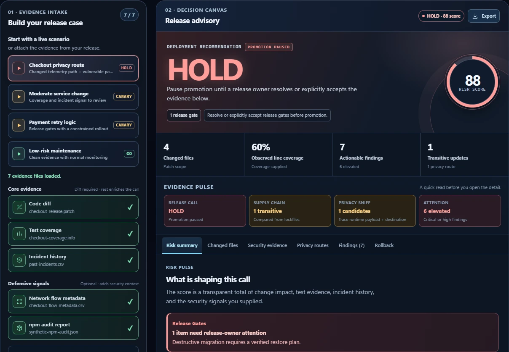
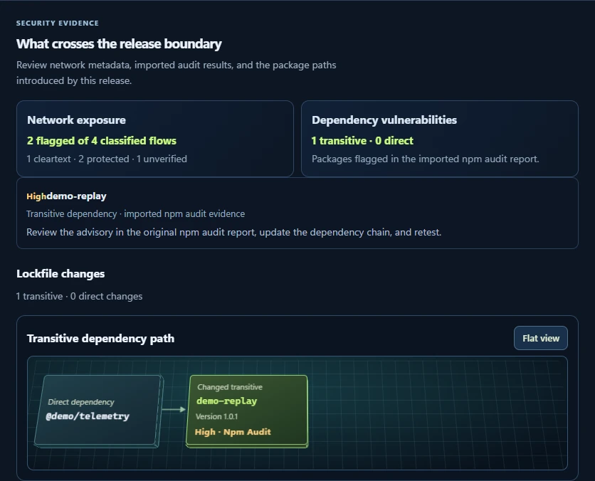

# ReleaseGuard

**Evidence-based deployment review for release owners**

ReleaseGuard brings code changes, test coverage, incident history, and security evidence into a single release review. It returns a **GO**, **CANARY**, or **HOLD** recommendation with a risk breakdown, evidence for each finding, and a rollback checklist. The release owner makes the deployment decision.

Built by **Team LLmborghini** for **Agent Forge**.

[Demo video link](DEMO%20VIDEO%20LINK.txt) · [Submission deck](Releaseguard%20Final%20PPT.pptx) · [Run the checkout demo](#demo-walkthrough)

---

## Highlights

- **Network sniffing exposure.** Review supplied, classified network-flow metadata for sensitive data on cleartext or unverified transport. The app uses metadata from your monitoring workflow.
- **Transitive dependencies and vulnerabilities.** Import an npm audit report, compare baseline and proposed lockfiles, and inspect dependency paths in 3D or flat view.
- **Data privacy and sensitive data.** Flag sensitive fields and potential personal data in logs. Trace candidate exposure from changed JavaScript or TypeScript code through a direct npm dependency to a changed transitive package.
- **Explainable release gates.** Combine change impact, coverage, incident history, security, and privacy evidence with hard release gates and recommended actions.
- **Local execution.** Start with Python 3.10+ and its standard library. The server binds to loopback by default, analyzes evidence in memory, and exports a redacted JSON advisory.

---

## Quick start

Requires **Python 3.10** or newer.

```sh
python server.py
```

Then open [http://127.0.0.1:8765](http://127.0.0.1:8765) in your browser.

In PyCharm, open the repository folder, select a Python 3.10+ interpreter, and run the included **ReleaseGuard** configuration or `server.py`. In VS Code, run `server.py` with your selected interpreter.

### Environment configuration

| Variable | Default | Purpose |
| --- | --- | --- |
| `RELEASEGUARD_HOST` | `127.0.0.1` | HTTP server bind address |
| `PORT` | `8765` | HTTP server port |

To customize the port or host:
```sh
PORT=9000 python server.py
```
*(On Windows PowerShell: `$env:PORT=9000; python server.py`)*

---

## Repository architecture

```
ReleaseGuard/
├── engine.py                   # Core assessment engine, diff parser, coverage mapping & scoring
├── security_evidence.py        # Network flow metadata & npm audit report analysis
├── dependency_evidence.py      # npm lockfile graph comparison & candidate privacy routes
├── server.py                   # Local HTTP API and static file web server
├── test_dependency_evidence.py # Comprehensive test suite
├── web/                        # Web dashboard assets & demo fixtures
│   ├── index.html              # Accessible UI structure & upload controls
│   ├── app.js                  # Frontend state, streaming client & DOM rendering
│   ├── style.css               # Responsive stylesheet & 3D dependency visualization
│   ├── demo.json               # Full synthetic checkout fixture (HOLD)
│   ├── demo-moderate.json      # Moderate service change fixture (CANARY)
│   ├── demo-payments.json      # Payment retry fixture (CANARY)
│   └── demo-go.json            # Low-risk maintenance fixture (GO)
└── docs/screenshots/          # Advisory screenshots for documentation
```

---

## Demo walkthrough

Start with **Checkout privacy route**. It loads seven synthetic evidence files and returns **HOLD · 88/100**. The destructive migration triggers a restore-plan gate. Security evidence also flags two of four network flows and shows the high-severity npm audit finding for `demo-replay`, pulled in by `@demo/telemetry`.

The bundled scenarios cover all three recommendations.

| Scenario | How to start | Expected decision | Why? |
| --- | --- | --- | --- |
| **Checkout privacy route** | Select **Checkout privacy route**, then **Run assessment**. | **HOLD · 88/100** | A destructive database migration requires a verified restore plan. Supplied network metadata and npm audit results add security and privacy findings. |
| **Moderate service change** | Select **Moderate service change**, then **Run assessment**. | **CANARY · 24/100** | Touches the checkout critical path, leaves an added line uncovered, and matches a previous incident. |
| **Payment retry logic** | Select **Payment retry logic**, then **Run assessment**. | **CANARY · 19/100** | Coverage reaches 8 of 9 added executable lines, and incident INC-204 matches the changed module. |
| **Low-risk maintenance** | Select **Low-risk maintenance**, then **Run assessment**. | **GO · 0/100** | Copy update on receipt label is fully covered by tests and triggers no release gates. |

### Interactive exploration

1. Select **Checkout privacy route** and click **Run assessment**.
2. Watch the live stage-by-stage workflow progression (Prepare → Dependencies → Network → Privacy → Decision).
3. Open **Security evidence** to inspect the two flagged network flows and explore the 3D dependency path linking direct dependency `@demo/telemetry` to transitive package `demo-replay`. Toggle **Flat view** for a 2D layout.
4. Open **Privacy routes** to trace the candidate route from `src/checkout.js:3` through `@demo/telemetry` to `demo-replay`.
5. In **Findings**, filter by severity (Critical, High, Medium, Low) to review actionable remediation steps.
6. Open **Rollback** for the checklist, including choosing an owner, setting abort thresholds, and verifying recovery. Click **Export** to save the assessment as JSON.
7. Use **Try another scenario** to compare recommendations across scenarios.

### Screenshots

The release advisory recommends **HOLD** at **88/100** and identifies the restore-plan requirement:



Security evidence flags two network flows and traces the high-severity audit finding to a transitive dependency:



The privacy view links a potential exposure to `src/checkout.js:3` for runtime verification:


---

## Evidence and analysis

| Input | Format | How to generate | Analysis performed |
| --- | --- | --- | --- |
| **Code changes** *(Required)* | Unified diff or Git patch | `git diff main...HEAD > changes.patch` | Detects changed paths, critical areas (auth, billing), destructive schema changes, and static security/privacy anti-patterns. |
| **Test coverage** | LCOV (`.lcov`, `.info`) or `coverage.py` JSON | `coverage json -o coverage.json` | Maps executed and missed lines against added executable lines. Identifies untested changes. |
| **Incident history** | CSV with `id,module,severity` | Export from incident tracker | Correlates past incidents with modified modules using path-segment matching. |
| **Network flows** | CSV with `transport,destination_scope,data_class` | Export from network monitor / service mesh | Flags personal data or credentials sent over cleartext (`http`, `ftp`, `telnet`) or unverified transport. |
| **npm audit report** | JSON (`npm audit --json`) | `npm audit --json > audit.json` | Parses report version 2 vulnerabilities; distinguishes direct from transitive package risks. |
| **npm lockfiles** | Baseline and proposed `package-lock.json`, versions 2 or 3 | Current vs proposed branch lockfiles | Resolves dependency graph edges, identifies root-reachable updates, and checks package integrity metadata. |

*Each evidence file can be up to 750 KB. Use repository-relative paths and coverage data corresponding to the proposed release revision.*

### Security and privacy boundaries

- **Static code checks**: Scans added lines for potential secrets/keys, disabled TLS verification (`verify=False`, `rejectUnauthorized: false`), public network ingress (`0.0.0.0/0`), unsafe dynamic execution (`shell=True`, `eval()`), wildcard CORS (`*`), and personal data in logs.
- **Defensive network metadata**: Uses classification tags provided by the operator. Packet capture and payload inspection are outside the app’s scope.
- **Transitive dependency tracing**: Discovers candidate paths from source import statements to changed nested packages. ReleaseGuard flags candidate routes so teams can verify the runtime payload and destination.
- **Export sanitization**: Exported reports retain line locations and file names, but omit raw source code, matched secret strings, internal registry URLs, and integrity checksums.

### Release scoring and decisions

The composite risk score (0–100) sums five capped dimensions:
- **Change impact** (up to 30 points)
- **Test evidence** (up to 25 points)
- **Security** (up to 20 points)
- **Incident history** (up to 15 points)
- **Privacy** (up to 10 points)

| Recommendation | Assessment rule |
| --- | --- |
| **HOLD** | A hard release gate is active or the score is at least 45. Gates include destructive migrations and critical findings such as potential secrets or cleartext credentials. |
| **CANARY** | Without a HOLD condition: the score is 15–44, added executable lines lack coverage evidence, or a high-severity finding is present. |
| **GO** | The score is below 15, no release gate is active, all assessed added lines have known coverage, and no high or critical findings are present. |

---

## API reference

| Endpoint | Method | Format | Description |
| --- | --- | --- | --- |
| `/api/health` | `GET` | JSON | Service health status (`{"status": "ok"}`) |
| `/demo.json` | `GET` | JSON | Full checkout demo fixture bundle |
| `/demo-moderate.json` | `GET` | JSON | Moderate-risk fixture bundle |
| `/demo-payments.json` | `GET` | JSON | Payment retry fixture bundle |
| `/demo-go.json` | `GET` | JSON | Low-risk maintenance fixture bundle |
| `/api/assess` | `POST` | JSON | Synchronous complete risk assessment |
| `/api/assess/stream` | `POST` | NDJSON | Streaming assessment with stage-by-stage progress events |

### Request payload format

The `/demo*.json` fixtures return `{ "name": "...", "text": "..." }` objects. Both assessment POST endpoints accept plain text strings as artifact values. When reusing a fixture, send each artifact’s `text` value.
- `patch` *(string, required)*: The unified diff.
- `coverage` *(string, optional)*: LCOV or coverage.py JSON text.
- `incidents` *(string, optional)*: CSV text.
- `network_flows` *(string, optional)*: CSV text.
- `npm_audit` *(string, optional)*: npm audit JSON text.
- `baseline_lock` & `release_lock` *(string, optional, paired)*: Baseline and proposed lockfile texts.

### Quick curl example

```sh
# Health check
curl -s http://127.0.0.1:8765/api/health

# Run assessment with a minimal patch
curl -s -X POST http://127.0.0.1:8765/api/assess \
  -H "Content-Type: application/json" \
  -d '{"patch": "--- a/main.py\n+++ b/main.py\n@@ -0,0 +1,2 @@\n+def hello():\n+    return \"world\"\n"}'
```

### Python automation example

Run this while the server is active:

```python
import json
from urllib.request import Request, urlopen

base_url = "http://127.0.0.1:8765"

# Fetch moderate-risk demo bundle
with urlopen(f"{base_url}/demo-moderate.json") as response:
    fixture = json.load(response)

# Prepare plain-text payload
evidence = {key: artifact["text"] for key, artifact in fixture.items()}

# Request assessment
req = Request(
    f"{base_url}/api/assess",
    data=json.dumps(evidence).encode("utf-8"),
    headers={"Content-Type": "application/json"},
    method="POST",
)
with urlopen(req) as response:
    report = json.load(response)

print(f"Decision: {report['decision']} (Score: {report['score']}/100)")
# Expected output: Decision: CANARY (Score: 24/100)
```

---

## Tests and verification

Run the complete test suite:

```sh
python -m unittest -v
```

Verify Python and JavaScript syntax:

```sh
python -m py_compile engine.py server.py security_evidence.py dependency_evidence.py test_dependency_evidence.py
node --check web/app.js
```

The test suite covers:
- All four scenario decisions (**HOLD**, **CANARY**, **GO**).
- Transitive dependency resolution and candidate privacy route tracing.
- Export redaction for resolved registry URLs and integrity hashes.
- Tolerating empty context lines and quoted paths in unified diffs.
- Automatic UTF-8 BOM handling across inputs.
- Whitespace tolerance in coverage and case-insensitive incident module matching. Coverage paths must match repository-relative paths, including case.
- Input validation and malformed artifact rejection.

## Future scope

**Diamond dependency analysis** would show both paths when two packages pull in a shared dependency and highlight potential version conflicts. CI integration could collect evidence on each pull request, and checks against historical releases could help calibrate the scoring thresholds.
